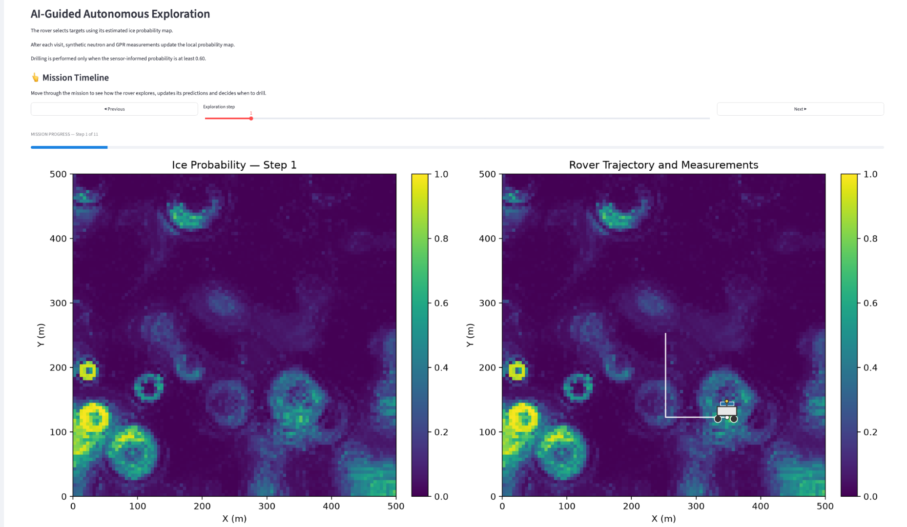
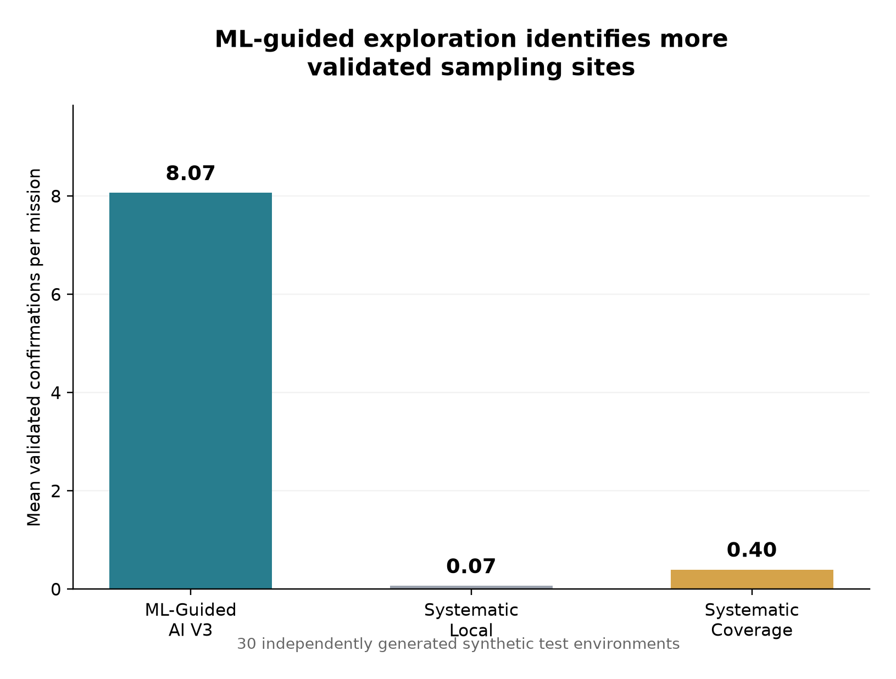

# 🌙 Lunar Explorer AI

**[🌙 Launch the Live Demo](https://lunar-explorer-ai-rappisi.streamlit.app/)** · **[GitHub Repository](https://github.com/earfrap/lunar-explorer-ai)**

### Machine Learning-Guided Autonomous Exploration for Lunar Water-Ice Discovery

**An independent Applied AI research project combining synthetic lunar environments, geophysical sensing, supervised machine learning, and autonomous mission planning.**



*Interactive simulation showing ML-estimated ice probability,
autonomous rover navigation, and geophysical sampling.*

Lunar Explorer AI investigates how an autonomous rover can use predictive information to prioritize exploration targets and improve scientific sampling efficiency.

The project includes a Python simulation framework, controlled mission benchmarks, statistical validation, and an interactive Streamlit dashboard.

> **Research prototype:** All lunar environments, geophysical measurements, and drilling observations are synthetic. This project does not model or validate the performance of a real lunar mission.

## Research Question

**Can an ML-guided autonomous rover improve the efficiency of accessible water-ice discovery compared with systematic exploration under controlled synthetic lunar conditions?**

## Key Results

Across **30 independently generated synthetic test environments**, the ML-guided rover achieved substantially more validated sampling-site confirmations than two deterministic exploration baselines.

| Metric | ML-Guided Rover (AI V3) | Systematic Local | Systematic Coverage |
|---|---:|---:|---:|
| Validated confirmations / mission | **8.07** | 0.07 | 0.40 |
| Measurements / mission | **19.33** | 20.00 | 15.07 |
| Distance travelled / mission | 1,512 m | 257 m | 1,994 m |
| Confirmations per 100 m (pooled) | **0.533** | 0.026 | 0.020 |
| Drilling success rate (pooled) | 45.7% | 14.3% | 38.7% |

Compared with Systematic Coverage:

- **+7.67 validated confirmations per mission**, on average.
- **95% paired bootstrap confidence interval:** +5.17 to +10.27.
- **481 m less distance travelled**, on average.
- **4.27 more measurements per mission**, on average.

The results suggest that ML-guided target selection combined with autonomous planning can improve sampling efficiency within the investigated synthetic environments.

The experiments do **not** establish that the AI strategy has a higher success probability for an individual drilling attempt. They also do not establish performance on real lunar terrain.

See [Scientific Report](docs/SCIENTIFIC_REPORT.md) for experimental design, statistical results, and limitations.


### Mission Performance



The ML-guided rover achieves substantially more validated
sampling-site confirmations than the deterministic baselines.

## Interactive Dashboard

The Streamlit dashboard allows users to explore synthetic lunar environments and observe simulated rover missions.

It integrates environmental maps, rover navigation, geophysical observations, and mission performance metrics.

**Run locally:**

```bash
streamlit run app.py
```

**[Open the public Streamlit demo](https://lunar-explorer-ai-rappisi.streamlit.app/)** to try the dashboard directly in your browser.

See [Demo Guide](docs/DEMO.md).

## System Architecture

The simulation integrates five main components:

**1. Synthetic Lunar Environment**

Generates spatially varying terrain and environmental properties, including temperature, slope, ice content, and ice depth.

**2. Simulated Geophysical Sensors**

Provides simplified neutron and ground-penetrating radar (GPR) measurements, together with simulated drilling observations.

**3. Supervised Machine Learning**

Uses Random Forest models trained on synthetic data to estimate ice-related probabilities from environmental and sensor observations.

**4. Autonomous Mission Planning**

Combines predictive target selection, terrain constraints, pathfinding, and a finite travel budget to guide rover exploration.

**5. Scientific Validation**

Evaluates sampling-site detections, drilling confirmations, travel distance, and exploration efficiency against deterministic baselines.

### Mission Workflow

```text
Synthetic Lunar Environment
            |
            v
 Environmental Information
            |
            v
  ML-Based Target Selection
            |
            v
 Autonomous Path Planning
            |
            v
 Geophysical Measurements
            |
            v
 ML-Assisted Drilling Decision
            |
            v
 Validated Sampling-Site Result
            |
            v
 Mission Performance Evaluation
```

## Experimental Design

The final mission comparison uses:

| Parameter | Configuration |
|---|---|
| Test environments | 30 |
| Test seeds | 7000–7029 |
| Environment grid | 100 × 100 cells |
| Grid resolution | 5 m |
| Maximum measurements | 20 |
| Maximum travel distance | 2,000 m |
| Maximum traversable slope | 25° |
| Main ML model | Random Forest |
| Training samples | 10,000 synthetic observations |

Three strategies are evaluated:

- **AI V3:** ML-guided destination selection with autonomous, budget-aware planning.
- **Systematic Local:** deterministic exploration concentrated near the initial rover location.
- **Systematic Coverage:** deterministic spatial sampling across the environment, subject to pathfinding and mission constraints.

The systematic strategies use the same ML-assisted drilling decision mechanism, helping isolate differences associated with exploration planning.

All mission comparisons use the same test environment seeds.

## Scientific Interpretation

The largest observed benefit is associated with reaching promising sampling locations efficiently.

The AI strategy obtains more confirmations while using less travel distance than the spatial coverage baseline.

However, drilling success rates are considerably closer than total confirmation counts, and the paired confidence interval for the drilling-success difference includes zero.

This distinction suggests that **where the rover chooses to explore** is a major contributor to the observed mission-level improvement.

These conclusions are limited to the implemented simulator and baselines.

## Installation

Python **3.12.15** was used during development.

Clone the repository:

```bash
git clone https://github.com/earfrap/lunar-explorer-ai.git
cd lunar-explorer-ai
```

Create and activate a virtual environment:

```bash
python -m venv .venv
source .venv/bin/activate
```

On Windows, activate with:

```powershell
.venv\Scripts\activate
```

Install dependencies:

```bash
pip install -r requirements.txt
```

Launch the dashboard:

```bash
streamlit run app.py
```

The dashboard configures its project import paths automatically.

## Reproducing the Main Benchmark

From the repository root:

```bash
PYTHONPATH=src python tests/benchmark_coverage.py
```

The benchmark trains the original predictor and evaluates the three exploration strategies across the specified synthetic test environments.

Results are written to:

```text
results/benchmarks/benchmark_coverage_results.csv
```

The complete experiment may take some time depending on the machine.

## Repository Structure

```text
lunar-explorer-ai/
├── app.py
├── README.md
├── requirements.txt
├── src/
│   └── lunar_explorer/
│       ├── environment.py
│       ├── sensors.py
│       ├── rover.py
│       ├── ice_predictor.py
│       ├── accessible_ice_predictor.py
│       ├── hybrid_ice_predictor.py
│       ├── mission_planner.py
│       ├── mission_planner_v3.py
│       ├── scientific_metrics.py
│       └── spatial_metrics.py
├── tests/
├── results/
│   ├── benchmarks/
│   └── reports/
└── docs/
    ├── SCIENTIFIC_REPORT.md
    ├── DEMO.md
    └── figures/
```

## Scientific Limitations

This project is an exploratory simulation, not a validated lunar mission system.

Key limitations include:

- Entirely synthetic environments and measurements.
- Simplified geophysical sensor responses.
- Training and testing within the same synthetic environment family.
- Deterministic baselines that are not globally optimized.
- Confirmed sampling sites are not necessarily independent geological deposits.
- No demonstrated transfer to real lunar observations or hardware.

See the [Scientific Report](docs/SCIENTIFIC_REPORT.md) for further discussion.

## Future Research

Potential extensions include physically calibrated lunar datasets, more realistic sensor models, optimized exploration baselines, uncertainty-aware planning, and evaluation under environmental distribution shifts.

## Project Scope

**Independent R&D / Applied AI portfolio project**

Focus areas: scientific simulation, geophysical sensing, supervised machine learning, autonomous decision-making, and experimental validation.
