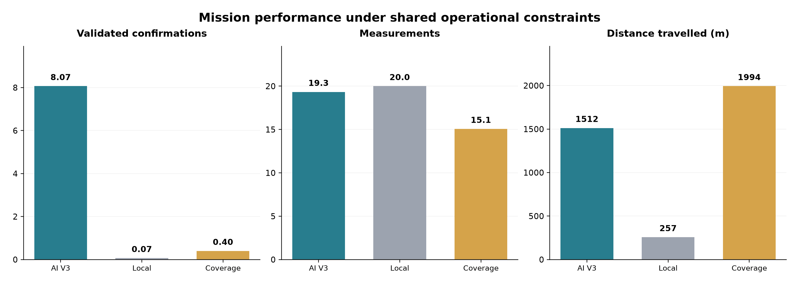
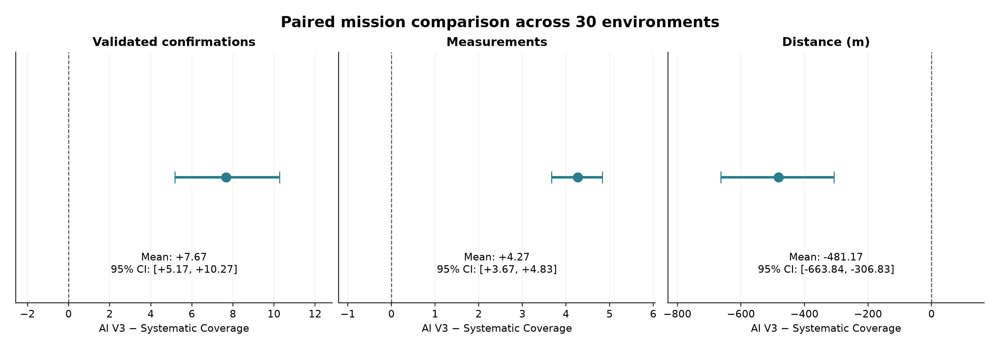
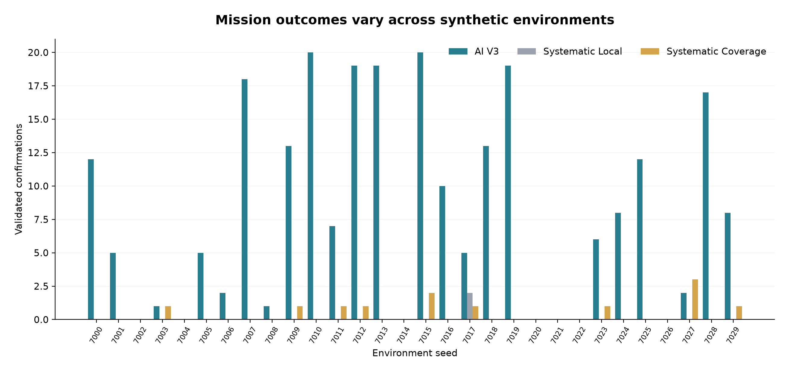

# Lunar Explorer AI — Scientific Report

## 1. Research Objective

This study investigates whether machine-learning-guided autonomous exploration improves accessible water-ice sampling efficiency relative to deterministic exploration strategies in controlled synthetic lunar environments.

The project evaluates an integrated simulation rather than a new machine-learning algorithm or a flight-ready rover system.

## 2. Simulation Framework

### 2.1 Synthetic Environment

The simulation represents lunar terrain on a 100 × 100 grid with a spatial resolution of 5 m.

Environmental fields include terrain slope, temperature, ice content, and ice depth.

The synthetic ice distribution is generated by the simulation framework and should not be interpreted as a physically calibrated representation of lunar polar deposits.

### 2.2 Geophysical Sensing

The rover uses simulated neutron and ground-penetrating radar measurements.

These observations provide imperfect information about the synthetic subsurface environment.

A separate simulated drilling measurement is used for site-level validation.

The sensor models are simplified and do not reproduce complete instrument physics.

### 2.3 Supervised Learning

The main predictive model uses a Random Forest trained on 10,000 synthetic samples drawn from 20 training environments.

The original predictor estimates ice-related probabilities using environmental features and, after measurement, additional geophysical observations.

Alternative predictors targeting accessible ice and hybrid configurations were also investigated.

The final mission benchmark uses the original IcePredictor.

### 2.4 Autonomous Planning

The rover selects candidate sampling locations using predictive information.

Pathfinding accounts for terrain constraints, including a maximum traversable slope of 25 degrees.

The final AI V3 planner incorporates travel-budget-aware exploration.

The maximum mission distance is 2,000 m, with up to 20 sampling measurements.

## 3. Scientific Metrics

The simulation distinguishes between:

- **Ice detection:** a sampled location satisfies the synthetic ice-content ground-truth criterion.
- **Accessible ice:** a location satisfies the ice-content criterion and has ice depth within the accessible range.
- **Drilling confirmation:** a drilling attempt yields a positive simulated measurement and the site satisfies the accessible-ice ground-truth criterion.

The implemented scientific metrics use an ice-content threshold of 0.35 and a maximum accessible depth of 1.0 m.

A validated confirmation represents a sampled grid location, not necessarily a unique geological deposit.

The main mission metrics are:

- Number of measurements.
- Number of ice detections.
- Number of drilling attempts.
- Number of validated confirmations.
- Total travel distance.
- Confirmations per 100 m.
- Confirmations per drilling attempt.

Pooled efficiency metrics are calculated from aggregate counts, while mission-level summaries describe variation across environments.

## 4. Experimental Design

### 4.1 Training and Evaluation

The original predictor is trained using synthetic samples generated from training environments.

The final mission evaluation uses 30 test environments with seeds 7000–7029.

The training and test environments are separate realizations from the same synthetic generator.

### 4.2 Exploration Strategies

**AI V3**

Uses ML-guided destination selection and budget-aware autonomous planning.

**Systematic Local**

Uses deterministic local exploration around the starting region.

**Systematic Coverage**

Uses a deterministic spatial-coverage pattern with pathfinding and mission constraints.

Both systematic baselines use ML-assisted drilling decisions. Thus, the experiment principally compares exploration policies rather than independently trained drilling classifiers.

The coverage baseline is not an optimized coverage planner.

### 4.3 Mission Constraints

| Parameter | Value |
|---|---:|
| Test environments | 30 |
| Maximum measurements | 20 |
| Maximum distance | 2,000 m |
| Maximum traversable slope | 25° |
| Grid resolution | 5 m |

### 4.4 Statistical Comparison

Mission results are paired by environment seed.

Mean paired differences are reported together with 95% bootstrap confidence intervals based on resampling the environment-level paired differences.

These intervals characterize variability under the evaluated synthetic environment distribution; they do not establish external validity for lunar operations.

## 5. Predictive Validation

A separate comparison evaluated the predictive value of adding synthetic geophysical measurements to environmental features.

Across 30 synthetic test environments:

| Model information | Mean ROC-AUC |
|---|---:|
| Environmental prior | 0.872 |
| Environmental + sensor observations | 0.905 |

The observation-based model improved ROC-AUC in 27 of 30 environments.

An alternative model trained to predict accessible ice showed higher precision but lower recall at the evaluated operating point.

These predictive experiments should not be interpreted as demonstrating superior mission-level performance for the alternative models.

## 6. Final Mission Results

### 6.1 Mission-Level Summary

| Metric | AI V3 | Systematic Local | Systematic Coverage |
|---|---:|---:|---:|
| Measurements, mean | 19.333 | 20.000 | 15.067 |
| Detections, mean | 14.533 | 2.067 | 2.300 |
| Validated confirmations, mean | 8.067 | 0.067 | 0.400 |
| Drilling attempts, mean | 17.667 | 0.467 | 1.033 |
| Distance, mean (m) | 1512.333 | 256.833 | 1993.500 |
| Pooled confirmations / 100 m | 0.533 | 0.026 | 0.020 |
| Pooled confirmations / drill | 0.457 | 0.143 | 0.387 |

The AI V3 strategy produces substantially more validated confirmations than either deterministic baseline.

Systematic Coverage uses nearly the entire distance budget while completing fewer measurements.

### 6.2 Paired Comparison: AI V3 vs Systematic Coverage

| Metric | Mean difference (AI − Coverage) | 95% bootstrap CI |
|---|---:|---|
| Validated confirmations | +7.667 | [+5.167, +10.267] |
| Confirmations per 100 m | +0.766 | [+0.441, +1.134] |
| Confirmations per drill | +0.073 | [−0.144, +0.284] |
| Distance (m) | −481.167 | [−663.837, −306.829] |
| Measurements | +4.267 | [+3.667, +4.833] |

For validated confirmations, AI V3 outperformed Systematic Coverage in 21 environments, underperformed in one, and tied in eight.

The paired confidence interval for confirmations per drill includes zero.

### 6.3 Paired Comparison: AI V3 vs Systematic Local

| Metric | Mean difference (AI − Local) | 95% bootstrap CI |
|---|---:|---|
| Validated confirmations | +8.000 | [+5.467, +10.633] |
| Confirmations per 100 m | +0.735 | [+0.383, +1.129] |
| Distance (m) | +1255.500 | [+1071.163, +1432.008] |
| Measurements | −0.667 | [−1.267, −0.167] |

The local baseline travels substantially less than AI V3, making it a weaker comparator for broad spatial exploration.


### Experimental Figures

**Mission performance and resource utilization**



**Paired comparison with the spatial coverage baseline**



**Environment-level variability**



## 7. Interpretation

The most pronounced difference is in mission-level validated confirmations.

AI V3 achieves approximately 20 times as many confirmations per mission as Systematic Coverage, while travelling less distance and completing more measurements.

The large difference in drilling attempts indicates that the ML-guided strategy reaches locations where the shared drilling classifier is more likely to recommend sampling.

However, the observed paired difference in confirmations per drilling attempt is not conclusive.

The evidence therefore supports a mission-level benefit associated with target selection and planning, but does not independently isolate the contribution of each planning component.

## 8. Limitations

### 8.1 Synthetic Physical Environment

Environmental relationships are generated rather than inferred from real lunar observations.

Performance may depend on assumptions embedded in the synthetic generator.

### 8.2 Simplified Sensor Models

The neutron, GPR, and drilling measurements are synthetic approximations.

Instrument response, calibration, geological ambiguity, and operational effects are not comprehensively represented.

### 8.3 In-Distribution Testing

Training and test environments are distinct, but sampled from the same synthetic generator family.

Out-of-distribution generalization remains untested.

### 8.4 Baseline Strength

The two deterministic strategies provide useful references but are not optimized exploration policies.

The results should not be interpreted as demonstrating superiority over every non-ML exploration strategy.

### 8.5 Sampling-Site Dependence

Multiple validated cells may belong to a single spatially continuous ice-bearing region.

The number of confirmations is therefore not equivalent to the number of independent ice deposits discovered.

### 8.6 Sources of Uncertainty

The analysis includes variation across 30 environment realizations.

It does not comprehensively vary the model-training seed, sensor calibration, terrain generator assumptions, or geological parameterization.

### 8.7 Operational Simplifications

The simulator does not provide a full representation of rover energy use, communication delays, thermal conditions, hardware failure, or mission operations.

## 9. Conclusions

This study investigated whether machine-learning-guided autonomous exploration could improve accessible water-ice discovery under controlled synthetic lunar conditions.

A simulation framework integrating synthetic terrain, simplified geophysical sensing, supervised machine learning, autonomous path planning, and drilling-based validation was developed and evaluated.

Across 30 test environments, the ML-guided rover achieved an average of 8.07 validated sampling-site confirmations per mission, compared with 0.07 and 0.40 for local systematic exploration and spatial coverage baselines, respectively.

Compared with Systematic Coverage, ML-guided exploration produced an average of 7.67 additional confirmations per mission (95% paired bootstrap confidence interval: 5.17–10.27), while travelling approximately 481 m less.

These findings suggest that predictive target selection combined with budget-aware autonomous planning can substantially improve sampling efficiency within the investigated synthetic environments.

However, the improvement was not accompanied by a clearly established increase in drilling success probability. The main observed advantage is therefore associated with exploration-site selection and mission-level planning rather than a demonstrated improvement in individual drilling outcomes.

Further work involving physically calibrated lunar data, alternative exploration policies, and broader uncertainty analysis is required before drawing conclusions about real lunar missions.

## 10. Reproducibility

The final comparison can be reproduced from the repository root:

```bash
PYTHONPATH=src python tests/benchmark_coverage.py
```

Primary results:

`results/benchmarks/benchmark_coverage_results.csv`

Other benchmark outputs and diagnostic summaries are preserved in `results/benchmarks/` and `results/reports/`.

The project was developed using Python 3.12.15.
